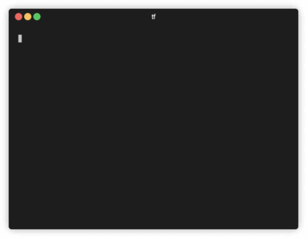
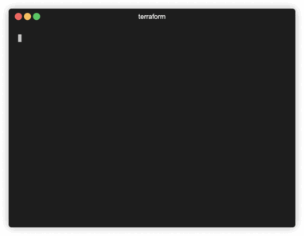

# tf

[](https://github.com/dex4er/tf)
[](https://github.com/dex4er/tf/actions/workflows/test.yaml)
[](https://github.com/dex4er/tf/actions/workflows/trunk-check.yaml)
[](https://github.com/dex4er/tf/actions/workflows/main-scan.yaml)

Less verbose, more shell-friendly and LLM-friendly Terraform and OpenTofu.

| Better this:                                               | Than this:                                                             |
| ---------------------------------------------------------- | ---------------------------------------------------------------------- |
| [](assets/tf.gif) | [](assets/terraform.gif) |

The original Terraform and OpenTofu are abusively oververbosed. The `tf`
wrapper runs either of them and makes it more CLI-friendly:

- removes unnecessary output
- adds own colored progress indicator
- provides an extra compact mode
- allows to use of multiple arguments when original command doesn't support it
- adds automatically quotes for indexed resources (`xargs` friendly)
- generates a log file when `TF_OUTPUT_PATH` environment variable is used

`tf` is optimized for LLM coding agents too: its output takes a fraction of
the tokens of the output of Terraform or OpenTofu, and its resource addresses
need no shell quoting. Under an agent the token-saving mode is on by default,
without colors and without the progress indicator (see
[Coding agents](#coding-agents)).

## Install

Download from [releases](https://github.com/dex4er/tf/releases). Put anywhere
in the `$PATH`.

### Verify

Since v2.14.1 every release carries a build provenance attestation and an SPDX
SBOM (`*.sbom.json`) for each binary. Verify a downloaded binary with
[GitHub CLI](https://cli.github.com/):

```sh
gh attestation verify tf-linux-amd64 --repo dex4er/tf
```

### asdf

Install with [asdf](https://asdf-vm.com/):

```sh
asdf plugin-add tf https://github.com/dex4er/asdf-tf.git
asdf install tf latest
asdf global tf latest
```

### mise

Install with [mise-en-place](https://mise.jdx.dev/):

```sh
mise plugins install tf https://github.com/dex4er/asdf-tf.git
mise use -g tf@latest
```

### Homebrew

Install with [homebrew](https://brew.sh/):

```sh
brew tap dex4er/tap
brew install --cask tf
```

Since v2.14.1 the tap ships a cask rather than a formula, on both macOS and
Linux. If you installed the formula earlier, `brew upgrade` migrates you over
automatically.

### Zsh

With Zsh `noglob` should be used to prevent errors when indexed parameters
are arguments for `tf` command.

Add to `~/.zshenv`:

```sh
alias tf='noglob tf'
```

You can re-use the completion of the Oh My Zsh plugin dedicated to the
original Terraform, whether `tf` runs Terraform or OpenTofu:

```sh
compdef _terraform tf
```

## Usage

```sh
tf init
tf plan
tf apply
tf list
tf show
```

etc...

You can combine commands, ie.:

```sh
tf apply $(tf list | grep aws_vpc)
tf list | grep data.aws_region.current | xargs tf refresh
tf list | grep random_password | xargs tf rm
tf list | grep aws_subnet | xargs tf show
tf list | grep module.one | while read r; do echo tf mv $r ${r/module.one./module.two.}; done | bash -x
tf list | fzf | xargs tf show | highlight -O xterm256 --syntax terraform
```

It is recommended to use `$()` rather than `xargs` for `tf apply` or `tf destroy` because these commands are interactive.

For not recognized commands `tf` passes all arguments to `terraform` or
`tofu` command.

### Terraform or OpenTofu

`tf` runs `tofu` if a `.opentofu-version` file exists in the current
directory or in one of the parent directories and there was no
`.terraform-version` file in a directory nearer to the current one. Otherwise
it runs `terraform`.

The command might be set explicitly with `TERRAFORM_PATH` environment
variable, ie.:

```sh
export TERRAFORM_PATH=tofu
```

### Coding agents

When `tf` runs under a coding agent, it turns the colors off and hides the
progress indicator, as with `-no-color -quiet`. It recognizes the agent by the
`AI_AGENT` environment variable, or by the variables of Claude Code, Codex,
opencode and GitHub Copilot. `TF_AGENT=true` or `TF_AGENT=false` overrides the
detection, and the options of the command line still win.

The `NO_COLOR` environment variable turns the colors off too.

### `tf apply`

The same as `apply` of Terraform or OpenTofu, with less verbose output.

Instead of Reading/Creating/Destroying... messages it will show a short progress
indicator.

It will skip `(known after apply)` lines from the `-short` mode output. Also
it will hide a plan for data sources (`data.xxx will be read during apply`
blocks) from the `-short` and `-compact` mode output.
Additional options can be used: `-plan=FILE` which is passed as an argument to
`terraform apply` or `tofu apply`, `-counters` shows counters with processed
resources, `-compact` skips the content of the resources, `-short` removes
unecessary lines (default), `-full` keeps original manifest, `-fan` hides
messages about progress and shows short indicator (default), `-dots` hides
messages about progress and shows single dot or character for each line,
`-quiet` hides messages about progress and prints no progress indicator,
`-verbatim` keeps original messages about progress, `-verbose` adds counters
to original messages (default if `TF_IN_AUTOMATION=1`), `-no-outputs` hides
outputs (default, `-no-outputs=false` shows it again).

The command accepts the resource name as an argument, with or without the
`-target=` option. If the argument misses quotes inside square brackets then
they will be added.

The command will log to the file named in `TF_OUTPUT_PATH` environment
variable. The file name is resolved with `strftime`'s `%` sequences.

The variable `TF_PLAN_FORMAT` switches the default format for the plan
(compact, short, full). The variable `TF_PROGRESS_FORMAT` switches the
default format for the progress indicator (counters, fan, dots, progress,
verbose, verbatim).

### `tf destroy`

The same as `destroy` of Terraform or OpenTofu, with less verbose output.

Instead of Reading/Creating/Destroying... messages it will show a short progress
indicator.

It will skip `(known after apply)` lines from the `-short` mode output. Also
it will hide a plan for data sources (`data.xxx will be read during apply`
blocks) from the `-short` and `-compact` mode output.

Additional options can be used: `-counters` shows counters with processed
resources, `-compact` skips the content of the resources, `-short` removes
unnecessary lines (default), `-full` keeps original manifest, `-fan` hides
messages about progress and shows short indicator (default), `-dots` hides
messages about progress and shows single dot or character for each line,
`-quiet` hides messages about progress and prints no progress indicator,
`-verbatim` keeps original messages about progress, `-verbose` adds counters
to original messages (default if `TF_IN_AUTOMATION=1`), `-no-outputs` hides
outputs (default, `-no-outputs=false` shows it again).

The command accepts the resource name as an argument, with or without the
`-target=` option. If the argument misses quotes inside square brackets then
they will be added.

The command will log to the file named in `TF_OUTPUT_PATH` environment
variable. The file name is resolved with `strftime`'s `%` sequences.

The variable `TF_PLAN_FORMAT` switches the default format for the plan
(compact, short, full). The variable `TF_PROGRESS_FORMAT` switches the
default format for the progress indicator (counters, fan, dots, progress,
verbose, verbatim).

### `tf import`

The same as `import` of Terraform or OpenTofu, with better handling of
arguments.

If the first argument misses quotes inside square brackets then they will be
added.

The command appends the third argument and more to the second with a space as
the separator.

The `tf show` for this resource is run after import unless additional option
`-no-show` has been used.

### `tf init`

The same as `init` of Terraform or OpenTofu, with less verbose output.

The command will log to the file named in `TF_OUTPUT_PATH` environment
variable. The file name is resolved with `strftime`'s `%` sequences.

Additional option `-codesign` causes that all providers will have replaced
existing signature and checksums will be removed from the lock file. It will
allow to run providers by Terraform or OpenTofu on macOS when the system
blocks applications with unrecognized signature.

### `tf list`

The same as `state list` of Terraform or OpenTofu, with less verbose output
and ANSI stripped.

If the argument misses quotes inside square brackets then they will be added.

### `tf mv`

The same as `state mv` of Terraform or OpenTofu, with less verbose output.

If the argument misses quotes inside square brackets then they will be added.

### `tf plan`

The same as `plan` of Terraform or OpenTofu, with less verbose output.

Instead of Reading... messages it will show a short progress indicator.

It will skip `(known after apply)` lines from the `-short` mode output. Also,
it will hide a plan for data sources (`data.xxx will be read during apply`
blocks) from the `-short` and `-compact` mode output.

Additional options can be used: `-counters` shows counters with processed
resources, `-compact` skips the content of the resources, `-short` removes
unnecessary lines (default), `-full` keeps original manifest, `-fan` hides
messages about progress and shows short indicator (default), `-dots` hides
messages about progress and shows single dot or character for each line,
`-quiet` hides messages about progress and prints no progress indicator,
`-verbatim` keeps original messages about progress, `-verbose` adds counters
to original messages (default if `TF_IN_AUTOMATION=1`).

The command accepts the resource name as an argument, with or without the
`-target=` option. If the argument misses quotes inside square brackets then
they will be added.

The command will log to the file named in `TF_OUTPUT_PATH` environment
variable. The file name is resolved with `strftime`'s `%` sequences.

The variable `TF_PLAN_FORMAT` switches the default format for the plan
(compact, short, full). The variable `TF_PROGRESS_FORMAT` switches the
default format for the progress indicator (counters, fan, dots, progress,
verbose, verbatim).

### `tf refresh`

The same as `refresh` of Terraform or OpenTofu, with less verbose output.

Additional options can be used: `-counters` shows counters with processed
resources, `-compact` skips the content of the resources, `-short` removes
unnecessary lines (default), `-full` keeps original manifest, `-fan` hides
messages about progress and shows short indicator (default), `-dots` hides
messages about progress and shows single dot or character for each line,
`-quiet` hides messages about progress and prints no progress indicator,
`-verbatim` keeps original messages about progress, `-verbose` adds counters
to original messages (default if `TF_IN_AUTOMATION=1`), `-no-outputs` hides
outputs (default, `-no-outputs=false` shows it again).

The command accepts the resource name as an argument, with or without the
`-target=` option. If the argument misses quotes inside square brackets then
they will be added.

The command will log to the file named in `TF_OUTPUT_PATH` environment
variable. The file name is resolved with `strftime`'s `%` sequences.

The variable `TF_PLAN_FORMAT` switches the default format for the plan
(compact, short, full). The variable `TF_PROGRESS_FORMAT` switches the
default format for the progress indicator (counters, fan, dots, progress,
verbose, verbatim).

### `tf rm`

The same as `state rm` of Terraform or OpenTofu, with less verbose output.

The command accepts multiple arguments. If the argument misses quotes inside
square brackets then they will be added.

### `tf show`

The same as `show` and `state show` of Terraform or OpenTofu, with less
verbose output and ANSI stripped.

`show` is used when the command is run without arguments and `state show`
when arguments are used.

The command accepts multiple arguments. If the argument misses quotes inside
square brackets then they will be added.

An additional option can be used: `-no-outputs` hides outputs (default,
`-no-outputs=false` shows it again).

### `tf taint`

The same as `taint` of Terraform or OpenTofu, and it accepts multiple
arguments. If the argument misses quotes inside square brackets then they will
be added.

### `tf untaint`

The same as `untaint` of Terraform or OpenTofu, and it accepts multiple
arguments. If the argument misses quotes inside square brackets then they will
be added.

### `tf upgrade`

The same as `init -upgrade` of Terraform or OpenTofu, with less verbose output.

The command will log to the file named in `TF_OUTPUT_PATH` environment
variable. The file name is resolved with `strftime`'s `%` sequences.

Additional option `-codesign` causes that all providers will have replaced
existing signature and checksums will be removed from the lock file. It will
allow to run providers by Terraform or OpenTofu on macOS when the system
blocks applications with unrecognized signature.

## Skill for coding agents

`tf` suits coding agents too: its output takes a fraction of the tokens of the
output of Terraform or OpenTofu, and its resource addresses need no shell
quoting. The skill that teaches an agent to use it is a plugin of
[Claude Code](https://code.claude.com/docs/en/plugins), whose `SKILL.md` other
agents read too:

```text
/plugin install tf --marketplace dex4er/tf
```

or from the shell, as the extensions of the editors have no `/plugin`:

```sh
claude plugin install tf --marketplace dex4er/tf
```

The skill is in
[plugins/tf/skills/tf/SKILL.md](plugins/tf/skills/tf/SKILL.md).

## License

Copyright (c) 2020-2025 Piotr Roszatycki <piotr.roszatycki@gmail.com>

[MIT](https://opensource.org/licenses/MIT)
